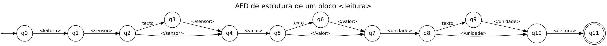
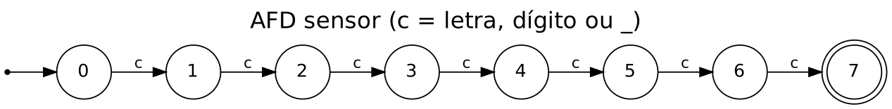
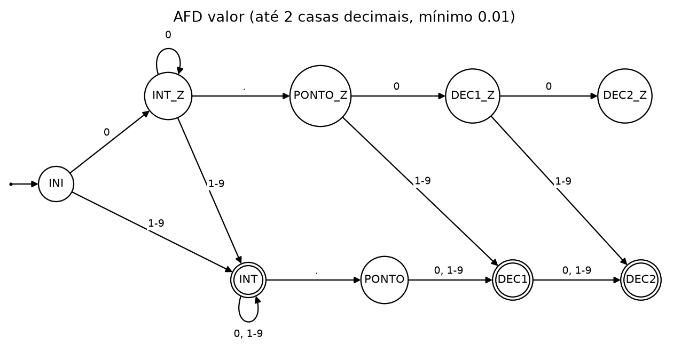
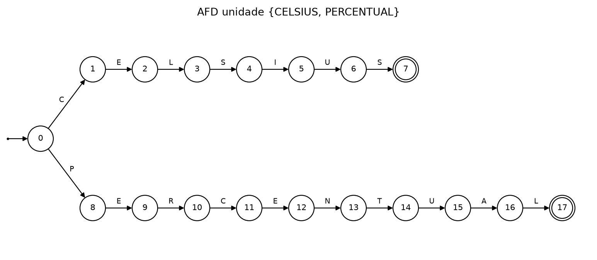

# Validador de Estrutura XML Plana

Projeto prático de **Teoria da Computação**, com a professora Eliane Loiola. Enunciado: *Grupo 04 – Validador de Estrutura XML Plana* ([docs/enunciado.pdf](docs/enunciado.pdf)).

O programa valida arquivos XML de telemetria de sensores industriais usando **autômatos finitos determinísticos (AFDs)**, sem nenhuma biblioteca de XML.

**Integrantes**

- Jonatas Alexandre Gomes Ribeiro
- Lucas de Melo Ventura
- Lucas Eduardo

## Como executar

Precisa só de Python 3, sem bibliotecas externas.

```
python validador.py testes/01_valido.xml
```

(No Linux/macOS, use `python3` se `python` não existir.)

Para ver, além de cada erro, a linha do arquivo e o ponto em que o autômato rejeitou a entrada:

```
python validador.py --detalhes testes/06_tipos.xml
```

Para rodar todos os testes (arquivos de exemplo + testes unitários dos AFDs):

```
python rodar_testes.py
```

Código de saída do validador: `0` = arquivo válido, `1` = arquivo com erros, `2` = uso incorreto ou arquivo não encontrado.

## Exemplo

```xml
<telemetria>
<leitura><sensor>TEMP_01</sensor><valor>24.5</valor><unidade>CELSIUS</unidade></leitura>
<leitura><sensor>UMID_02</sensor><valor>60</valor><unidade>PERCENTUAL</unidade></leitura>
</telemetria>
```

```
> python validador.py testes/01_valido.xml
Sucesso: Arquivo XML válido.

> python validador.py testes/05_erros_linha.xml
Erro de validação na linha 1: Estrutura inválida em <sensor>TEMP_01</sensor><valor>24.5</valor><unidade>CELSIUS</unidade></leitura>.
Erro de validação na linha 2: Tipo de dados inválido em <leitura><sensor>UMID_02</sensor><valor>AA</valor><unidade>PERCENTUAL</unidade></leitura>.

> python validador.py --detalhes testes/05_erros_linha.xml
Erro de validação na linha 1: Estrutura inválida em <sensor>TEMP_01</sensor><valor>24.5</valor><unidade>CELSIUS</unidade></leitura>.
  -> linha 2 do arquivo: o AFD de estrutura parou no estado q0 ao ler <sensor>; esperado <leitura>.
Erro de validação na linha 2: Tipo de dados inválido em <leitura><sensor>UMID_02</sensor><valor>AA</valor><unidade>PERCENTUAL</unidade></leitura>.
  -> linha 3 do arquivo: <valor>AA</valor>: o caractere 'A' (posição 1) não tem transição a partir do estado INI; esperado número >= 0.01 com até 2 casas decimais.
```

Sem `--detalhes`, a saída segue exatamente o formato do enunciado.

## Como funciona

1. **Análise léxica**: o arquivo inteiro vira uma sequência de tokens: tag de abertura, tag de fechamento e texto. Quebras de linha e indentação não importam. A declaração `<?xml ...?>` e os comentários `<!-- -->` são ignorados. O nome de cada tag é reconhecido por um AFD (`AFD_NOME_TAG`: uma ou mais letras); como no XML, `< leitura>` e `</ leitura>` são inválidos, mas `<leitura >` é aceito.
2. **Elemento raiz**: a sequência de tokens precisa ter a forma `<telemetria> X* </telemetria>`, em que X é qualquer outro token. Conteúdo antes da abertura ou depois do fechamento, e uma segunda tag `<telemetria>`, são erros sintáticos.
3. **Separação das leituras**: os tokens entre as tags raiz são divididos em blocos. Um bloco termina em `</leitura>`, ou quando aparece um novo `<leitura>`. Assim, um erro numa leitura não afeta as seguintes.
4. **AFD de estrutura**, aplicado a cada bloco: só aceita a sequência `<leitura> <sensor> T </sensor> <valor> T </valor> <unidade> T </unidade> </leitura>`. Tag faltando, fora de ordem, a mais ou não fechada leva à rejeição → *Estrutura inválida*.
5. **AFDs de tipo**, que só rodam se a estrutura for aceita → *Tipo de dados inválido*.

Todos os AFDs estão no código como tabelas de transição (δ, q0, F) e são executados pela mesma função `executar_afd`. Uma transição ausente na tabela leva a um estado de erro implícito, que rejeita a cadeia. Com esse estado de erro acrescentado, cada AFD fica completo.

**Por que um AFD basta?** O XML é **plano**: a profundidade é fixa (telemetria → leitura → campo) e o número de campos é fixo. Por isso a linguagem dos blocos válidos é regular, e não é preciso autômato com pilha para casar as tags. Um XML com aninhamento arbitrário já não seria regular, porque exige contar tags abertas.

## Autômatos

Os diagramas abaixo e os arquivos `.jff` são gerados a partir das mesmas tabelas de transição do código, pelo script [docs/gerar_automatos.py](docs/gerar_automatos.py) (`python docs/gerar_automatos.py`; o `.png` precisa do matplotlib). Um teste unitário compara cada `.jff` com o AFD do código, então um diagrama desatualizado faz os testes falharem. Os `.jff` em [docs/automatos/](docs/automatos/) abrem no **JFLAP 7.1** e podem ser simulados lá (*Input → Step by State*).

### Estrutura de um bloco `<leitura>`



O texto de cada campo é opcional *na estrutura* (transições q2→q4, q5→q7, q8→q10). Assim, um campo vazio como `<valor></valor>` é tratado como erro de **tipo**, não de estrutura.

No `.jff`, cada token é um símbolo: `L`=`<leitura>`, `l`=`</leitura>`, `S`/`s`=`<sensor>`/`</sensor>`, `V`/`v`=`<valor>`/`</valor>`, `U`/`u`=`<unidade>`/`</unidade>`, `t`=texto. Exemplo de cadeia aceita: `LStsVtvUtul`.

### Sensor: exatamente 7 caracteres, com pelo menos uma letra



Σ = {l, d}, em que l é uma letra e d é um dígito ou `_`. É o **AFD produto** de dois AFDs: um conta os caracteres lidos (0 a 7) e o outro lembra se já apareceu alguma letra. O estado `k` significa "k caracteres e nenhuma letra ainda"; `kL`, "k caracteres e pelo menos uma letra". Só `7L` é de aceitação, então `1234567` (só dígitos, um número e não um texto) é rejeitado. Os estados 7 e 7L não têm transição de saída, então um 8º caractere é rejeitado.

### Valor: número com até 2 casas decimais, mínimo 0.01



Os estados com sufixo `_Z` indicam que até agora só foram lidos zeros, e eles **não são de aceitação** (`0`, `0.0` e `0.00` são rejeitados). Como há no máximo 2 casas decimais, qualquer dígito diferente de zero garante valor ≥ 0.01. O limite mínimo é verificado sem nunca converter a cadeia em número. No `.jff`: `z` = `0`, `n` = `1`–`9`, `p` = `.`.

### Unidade: {CELSIUS, PERCENTUAL}



Toda linguagem finita é regular. O AFD é uma árvore de prefixos, construída pela função `construir_afd_palavras`.

## Mensagens

- `Erro: Arquivo xml vazio`
- `Erro sintático: Elemento <telemetria> não foi aberto.` / `... não foi fechado.`
- `Erro sintático: Conteúdo fora do elemento <telemetria> em ...`
- `Erro sintático: Elemento <telemetria> repetido em ...`
- `Erro de validação na linha N: Estrutura inválida em ...`
- `Erro de validação na linha N: Tipo de dados inválido em ...`
- `Sucesso: Arquivo XML válido.`

O programa lista todos os erros do arquivo, não só o primeiro.

## Decisões de interpretação

- **2 casas decimais**: o enunciado pede "2 casas decimais", mas o exemplo válido usa `24.5` e `60`. Por isso aceitamos valores com **até** 2 casas. Zeros à esquerda (`007`) são aceitos.
- **Sensor**: o exemplo `TEMP_01` contém dígitos e `_`, então "texto" inclui letras, dígitos e sublinhado. Mas o enunciado diz "apenas texto", então o sensor precisa ter **pelo menos uma letra**: `1234567` é um número, não um texto, e é rejeitado.
- **Ordem dos campos**: a leitura deve ter `sensor`, `valor` e `unidade` nessa ordem, como no exemplo do enunciado (igual a uma `sequence` de XML Schema).
- **`<telemetria>` sem leituras** (`<telemetria></telemetria>`) é válido: o enunciado não exige um número mínimo de leituras.
- **Numeração das linhas**: "linha N" é a N-ésima leitura dentro de `<telemetria>`, começando em 1, como no exemplo do enunciado. Se uma leitura ocupa várias linhas no arquivo, ela aparece na mensagem juntada numa linha só.
- **Formatação livre**: o XML pode estar todo numa linha ou indentado, com cada tag numa linha. Ver os testes 08 e 09.
- **Campo vazio** (ex.: `<valor></valor>`) é erro de **tipo**, não de estrutura, pois as tags estão corretas.
- **Espaços dentro de um campo** (ex.: `<valor> 24.5 </valor>`) tornam o dado inválido.
- **Atributos em tags** (ex.: `<leitura id="1">`) não fazem parte do formato e tornam a estrutura inválida.
- **Codificação**: arquivos em UTF-8 (com ou sem BOM) e Latin-1 são aceitos.

## Testes

Arquivos em [testes/](testes/), com as saídas esperadas em [testes/esperado/](testes/esperado/).

| Arquivo | Resultado esperado |
|---|---|
| 01_valido.xml | Sucesso (exemplo do enunciado) |
| 02_vazio.xml | Arquivo vazio |
| 03_sem_abertura.xml | `<telemetria>` não aberto |
| 04_sem_fechamento.xml | `<telemetria>` não fechado |
| 05_erros_linha.xml | Os dois erros do exemplo do enunciado |
| 06_tipos.xml | Sensor com 6 caracteres, 0.00, 3 casas, unidade inválida, valor vazio, ordem trocada, tag extra; a última leitura é válida |
| 07_limites_validos.xml | Sucesso (0.01, 0.10, 100, 1500000.75) |
| 08_uma_linha.xml | Sucesso (XML inteiro em uma linha) |
| 09_formatado.xml | Sucesso (declaração `<?xml?>`, comentário, indentação, uma tag por linha) |
| 10_erros_estrutura.xml | Leitura sem `</leitura>`, sem `<unidade>`, `<sensor>` sem fechar, tag com atributo; a última é válida |
| 11_conteudo_fora_raiz.xml | Leitura depois de `</telemetria>` |
| 12_raiz_repetida.xml | Dois elementos `<telemetria>` no mesmo arquivo |
| 13_tags_malformadas.xml | `< leitura>`, `</ sensor>`, `<valor/>`, `<SENSOR>`; a última (`<leitura >`) é válida |
| 14_sensor_texto.xml | Sensor só com dígitos, só com `_`, com `-`, com 8 caracteres, unidade minúscula; as duas últimas são válidas |

O `rodar_testes.py` também confere o código de saída (0 ou 1) e roda os testes unitários de [testes/test_validador.py](testes/test_validador.py): cadeias de fronteira para cada AFD, o analisador léxico, os casos do elemento raiz, o modo `--detalhes` e a conferência dos `.jff` com o código.

## Estrutura do repositório

```
validador.py              # o validador (léxico + AFDs)
rodar_testes.py           # roda todos os testes
testes/                   # arquivos XML de teste
testes/esperado/          # saída esperada de cada teste
testes/test_validador.py  # testes unitários dos AFDs
docs/enunciado.pdf        # enunciado do projeto
docs/automatos/           # AFDs em JFLAP (.jff) e imagens (.png)
docs/gerar_automatos.py   # gera os .jff e .png a partir do código
```
